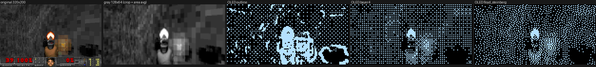

# doom-esp32

Doom on an ESP32-S3 with a 0.96 inch monochrome OLED, built to be played by the Drosophila
connectome "brain" running on an STM32H7 (the sibling project `drosophila`).
This repository is the game half. It is GPL-2.0-or-later (see THIRD_PARTY.md).

**Status (2026-10-20):** Phase 1 (display pipeline) shows frames on real hardware. Phase 2
(PrBoom on the S3) **boots on the board** and plays the shareware attract demos on the OLED
(seen on the panel; photos, no FPS recorded yet). The "layers" display style, which draws
sprites bright over dimmed walls, builds and is host tested but has not yet run on the board.
**Branch `doom-nano`** (local) adds the "nano" style, the default there: the look of the
doom-nano Arduino raycaster (flat shaded walls, black floors, crisp sprites, a health / kills /
ammo line) rebuilt for real Doom frames. It has been seen running on the panel (a visual check,
no FPS recorded yet). Its per class sprites (monsters with adaptive contrast and a hit flash,
corpses as dots, a shaded gun) have also been seen running on the panel (a visual check, no FPS
recorded yet).
See [Roadmap](#roadmap).



*Left to right: the original 320x200 frame, the 128x64 gray after crop and area average, then
what the OLED lights in the outline style (the stream demo's default, and the game's fallback
on screens without a 3D view), Bayer 4x4 and Floyd-Steinberg. In the game, 3D frames use the
layers style instead (see NOTES.md; DOOM1 preview sheets are not committed). Produced
by the same C code the ESP32 runs.*

## What works
* **Display pipeline (pure C, host tested):** `components/oled_pipeline`
  1. palette to gray lookup table with fixed levels (Rec.601 luma, black/white points, gamma)
  2. crop of the 3D view to the panel's 2:1 aspect (bottom aligned so the weapon stays in view),
     followed by an exact integer area-average downscale from 320x200 to 128x64
  3. 1 bit rendering: nano style (branch `doom-nano`: walls as flat shaded column runs with
     lit top and bottom pixels from an engine wall mask, black floors and ceilings, sprites
     drawn by class from an engine sprite id map with black halos between them, and an 8 row
     HUD), layers style (in the game: walls dim with geometry edges, sprites such
     as monsters, items and the weapon bright with a black halo, using a sprite mask from the
     engine), outline style (dimmed Bayer fill plus Sobel edges of a blurred frame; the
     default when there is no sprite mask), Bayer 4x4, or serpentine Floyd-Steinberg
  4. packing into SSD1306 page format (1024 bytes per frame)
* **Host tests:** 10 ctest suites (gray, scale, dither, outline and layers, sprite and wall
  masks, nano style, HUD, pack, demo stream parser, WAD validator) built
  with `-Werror -Wconversion`, ASan and UBSan. cppcheck and clang-tidy are clean (see NOTES.md
  for the excluded checks).
* **Hardware demo:** the laptop runs ViZDoom, does stages 1 and 2 with the same C code (through
  ctypes), and streams 128x64 gray frames over UART. The ESP32-S3 runs stages 3 and 4 and
  drives the SSD1306 over I2C. Frames have been seen on the real panel.

* **PrBoom app (Phase 2, boots on the board):** the engine from retro-go's
  `prboom-go` (marked patches: two on main, seven on branch `doom-nano`), our platform layer `components/doom_platform` (WAD read in
  place from a flash partition after validation, video through the pipeline, silent sound),
  and `tools/flash_wad.py`, which checks the WAD and the board's USB serial before writing.

## Measured so far
| What | Value | How |
|---|---|---|
| Pixels flipping per frame while walking (outline / Bayer / Floyd-Steinberg) | 15.9 / 5.8 / 26.6 % (E1M1), 17.7 / 7.4 / 35.7 % (deathmatch) | `host/preview/preview.py --stats`, 300 frame captures |
| Pixels flipping when a still frame brightens by 1 gray level | 0.09 / 0.17 to 0.29 / 27 to 36 % | same |
| Pixels flipping per frame, layers / outline (DOOM1.WAD, attract demo maps) | 7.6 / 14.7 % (E1M5), 8.0 / 11.0 % (E1M3), 4.0 / 6.5 % (E1M7) | 150 frame ViZDoom walks, sprite mask from ViZDoom's labels buffer (see NOTES.md) |
| Pixels flipping per frame, nano (branch `doom-nano`) | 9.7 % (E1M5), 9.3 % (E1M3), 5.0 % (E1M7) | same walks, wall and sprite masks from the labels buffer |

**Not yet measured on hardware:** achieved FPS, UART frame time, I2C time per frame, and
dither time per frame on the S3. The streamer prints all of these. They will be added here
once they are recorded from a real run.

## Hardware
* ESP32-S3 (QFN56, rev v0.2) with 8 MB embedded octal PSRAM and 16 MB quad flash, identified
  with esptool. PSRAM passed the boot memory test at 80 MHz.
* SSD1306 128x64 OLED module, I2C address 0x3C, 4 pin header (GND VDD SCK SDA).

### Pin map
| Signal | ESP32-S3 | Notes |
|---|---|---|
| OLED SDA | GPIO8 | internal pull-up enabled in addition to the module's |
| OLED SCL | GPIO9 | 400 kHz (1 MHz selectable for tests, out of spec) |
| OLED VCC / GND | 3V3 / GND | |
| Demo link TX / RX | GPIO43 / GPIO44 (UART0) | to the board's CH343 USB-UART bridge (COM connector) |

GPIO8 and GPIO9 avoid the strapping pins (0, 3, 45, 46), the flash and PSRAM pins (26 to 37)
and native USB (19, 20).

## Build and run

Host tests and tools:
```bash
cmake -S host -B host/build && cmake --build host/build && ctest --test-dir host/build
python3 -m venv .venv && .venv/bin/pip install -r host/requirements.txt
.venv/bin/python host/stream/capture_frames.py --scenario freedoom1 --frames 300 --out host/captures/freedoom1.npz
.venv/bin/python host/preview/preview.py host/captures/freedoom1.npz --frames 60 200 --outdir docs/preview --stats
```

PrBoom on the board. Confirm the port is the ESP32-S3 first; other boards
share the laptop. The WAD goes into its own partition once; the app is flashed separately:
```bash
. ~/esp/esp-idf/export.sh
idf.py -p /dev/ttyACM0 build flash          # app, bootloader, partition table
python tools/flash_wad.py --port /dev/ttyACM0 --serial <USB serial> --wad wad/doom1.wad
idf.py -p /dev/ttyACM0 monitor              # engine log + frame timing every 100 frames
```
The display style is a menuconfig option (`doom-esp32 OLED` > `Display style while playing`).

Phase 1 streaming demo (ESP-IDF v5.5.2):
```bash
. ~/esp/esp-idf/export.sh
cd demo/oled_stream && idf.py -p /dev/ttyACM0 flash && cd ../..
.venv/bin/python host/stream/stream_oled.py --port /dev/ttyACM0 --source live --frames 600
```
The OLED shows a centre bar while it waits for frames. Close `idf.py monitor` before streaming:
both programs use the same port. Use `--style bayer|fs|outline` to switch the style and
`--baud` to match `CONFIG_DEMO_UART_BAUD`. **Only 115200 baud has been seen working so far.**
The configured default of 2000000 has not been verified since the UART pin fix, and a 921600
overlay is in `demo/oled_stream/sdkconfig.defaults.921k` (the command is in that file).

## What is original and what is reused
* **Written for this project:** everything in `components/oled_pipeline`,
  `components/oled_driver`, `components/demo_stream`, `demo/oled_stream`, `tools/oled_probe`
  and `host/`.
* **Written for this project (Phase 2):** `components/doom_platform`, `main/`,
  `partitions.csv`, `tools/flash_wad.py`.
* **Reused:** the PrBoom 2.5.0 engine in `components/prboom` (from retro-go, GPL-2.0, seven
  marked patches on branch `doom-nano`, two on main), ESP-IDF, and ViZDoom with the Freedoom IWADs on the laptop only. Details and
  licenses are in THIRD_PARTY.md.

Design decisions, tradeoffs and alternatives are explained in [NOTES.md](NOTES.md).

## Roadmap
1. Record FPS and per-stage timing of the hardware demo (Bayer and outline, 400 kHz and 1 MHz).
2. Phase 2: record game FPS and the frame time breakdown on the board (the log prints it),
   confirm the layers style on the panel, and check `-timedemo demo1`. On branch `doom-nano`:
   record FPS with the per class sprites against the previous nano build, check the hit flash
   and death look specifically, and record the `walls` / `sprites` mask times.
3. Phase 3: GPIO buttons; a feature extractor per `drosophila/firmware/include/brain_protocol.h`
   (luminance from the un-stretched gray, before dithering; enemy position from the engine's
   object list); the brain UART link to the STM32 with timeouts and miss counting; a video of
   the brain playing.
4. Later: SPI or a larger display, I2S sound, a brain link reusing secure-boot's framing and
   CRC, and brain firmware updates through the secure-boot bootloader.

## Brain link (added in the drosophila copy of this tree)

`components/brain_link` and `components/doom_platform/i_brain_input.c` connect this game to the
STM32 brain (UART1: TX GPIO17, RX GPIO18, 115200 baud; to Nucleo USART1 PB7/PB6 = Arduino D0/D1). The brain's
turning drives the player; fire, walking, unsticking and respawn are labelled heuristics. The HUD's
middle field is the kill count. Details, wiring and status are in the drosophila README section
"Doom on the ESP32-S3 playing with the brain". Menuconfig: `doom-esp32 brain link`.
